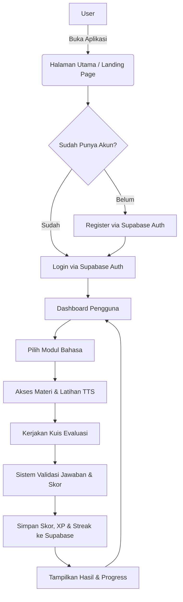

# LinguaNova 🌍

**LinguaNova** (*Nova Language Learning* / `lunaverse` oleh Kelompok Lunavera, SMKN 20 Jakarta) adalah aplikasi pembelajaran bahasa interaktif berbasis **Flutter** dan **Supabase** yang dirancang untuk membantu pengguna menguasai bahasa baru secara terstruktur, interaktif, dan menyenangkan.

## 🚀 Fitur Utama
- **Sistem Autentikasi**: Registrasi dan login pengguna yang aman menggunakan Supabase Auth (dilengkapi manajemen sesi dan profil pengguna).
- **Katalog Modul Bahasa**: Pilihan modul bahasa (Inggris, Jepang, Spanyol, Mandarin, dan Korea), termasuk bagan aksara **Hiragana** dan **Katakana** untuk Bahasa Jepang.
- **Materi, Audio & Kuis Interaktif**: Pembelajaran materi terstruktur, daftar kosakata (*Vocabulary*), dukungan pelafalan Text-to-Speech (`flutter_tts`), serta kuis evaluasi bahasa dan kuis Hiragana.
- **Dashboard Progress & Gamifikasi**: Pemantauan perkembangan belajar, histori skor kuis, perolehan XP, *daily streak*, kalender belajar, pencapaian (*Achievements*), dan sertifikat secara *real-time*.

## 🛠️ Tech Stack
Proyek ini dibangun menggunakan teknologi berikut:
- **Frontend / Mobile & Web**: Flutter (Dart SDK `^3.12.2`)
- **State Management & Routing**: `provider`, `go_router`
- **Backend & Database**: Supabase (Authentication, PostgreSQL dengan Row Level Security)
- **Fitur Pendukung**: `flutter_tts` (Text-to-Speech), `flutter_dotenv`, `shared_preferences`
- **Target Platform**: Android, iOS, Web, Windows, macOS, Linux

## 🗺️ Alur Kerja Aplikasi (Flowchart)



## ⚙️ Persiapan & Menjalankan Proyek

1. **Konfigurasi Database Supabase**
   - Jalankan skrip SQL pada `supabase/schema.sql` melalui Supabase SQL Editor untuk membuat tabel, trigger profil, kebijakan RLS, serta data awal modul bahasa.

2. **Konfigurasi Environment (`.env`)**
   - Pastikan file `.env` pada root proyek Flutter berisi variabel berikut:
     ```env
     SUPABASE_URL=https://<project-id>.supabase.co
     SUPABASE_PUBLISHABLE_KEY=<publishable-key-anda>
     ```

3. **Instalasi Dependensi & Jalankan Aplikasi**
   ```bash
   flutter pub get
   flutter run
   ```
